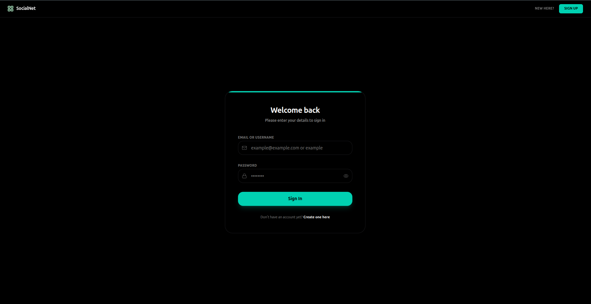
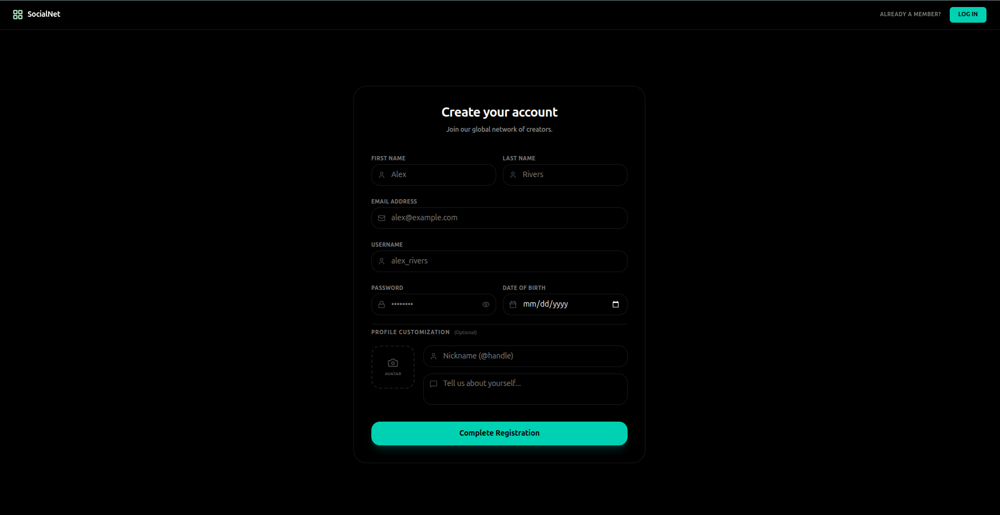
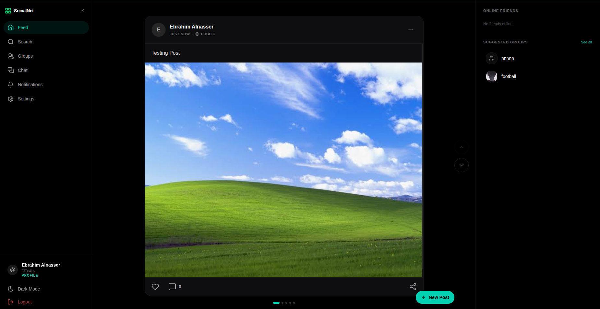
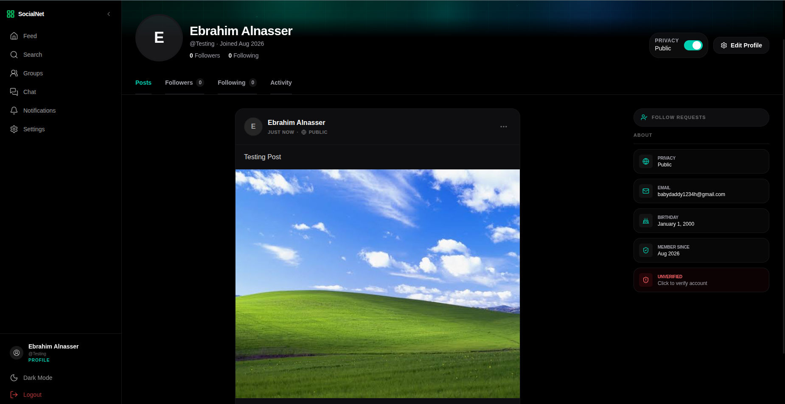
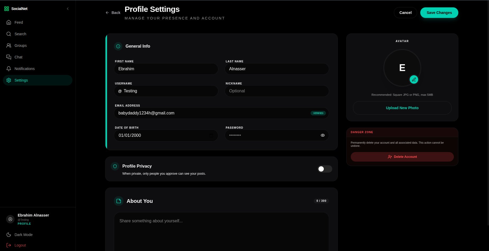

# SocialNet

A full-featured social platform — posts, followers, private & group chat, groups with events, live notifications, and email OTP verification. Built with a **Go** backend and a **Next.js / React** frontend, talking over REST **and** a persistent WebSocket.

Think of it as a small Facebook: you register, you follow people, you post, you talk. Except every moving part is ours.

---

## Why We Built This

Because building a social network forces you to solve every problem a real product has, all at once:

- **Identity & trust** — sessions, hashed passwords, email verification.
- **Relationships** — public vs. private profiles, follow requests, who's allowed to see what.
- **Real-time** — messages and notifications that arrive *now*, not on refresh.
- **State** — a UI that stays correct while data changes under it from another user's actions.
- **Files** — uploads that can't be used to attack you.

You can't fake your way through any of those. That's the point.

---

## The Stack, In Plain Words

| Layer | What we used | Why |
|---|---|---|
| Frontend | Next.js 16 + React 19 + TypeScript | App Router, file-based routing, typed everything |
| Styling | Tailwind CSS v4 | Utility-first, light/dark theming via CSS variables |
| Icons | lucide-react | Clean, tree-shakeable |
| Backend | Go 1.23, standard library `net/http` | No framework. Explicit routing, explicit middleware |
| Database | SQLite (`mattn/go-sqlite3`) | Zero-config, file-based, real SQL |
| Migrations | golang-migrate | Versioned, up/down, 23 migrations and counting |
| Real-time | gorilla/websocket | One socket per user, multiplexed by message type |
| Auth | bcrypt + server-side sessions | HttpOnly cookies, no tokens in JS |
| Email | Go `net/smtp` | OTP delivery, HTML templated |
| Deploy | Docker + docker-compose | Two containers, one command |

---

## How the Frontend and Backend Are Linked

Two separate processes. Two separate ports. They talk over **two channels**:

```
┌──────────────────────────┐                        ┌───────────────────────────┐
│   Next.js  :3000         │                        │   Go server  :8080        │
│                          │                        │                           │
│  app/     — pages        │ ── REST + cookie ────► │  server/router.go         │
│  components/ — UI        │ ◄──── JSON ─────────── │  internal/{auth,posts,…}  │
│  lib/     — API clients  │                        │            │              │
│                          │                        │            ▼              │
│  lib/ws/ws.ts ◄══════════╪══ WebSocket /ws ══════►│  internal/ws  ──► SQLite  │
└──────────────────────────┘                        └───────────────────────────┘
```

**1. REST — for everything you ask for.**
Every UI action goes through a typed client in [frontend/lib/](frontend/lib/) — `lib/auth/`, `lib/posts/`, `lib/groups/`, `lib/chat/`, `lib/users/`. Components never call `fetch` with a raw URL; they call a function. The base URL comes from one place, [lib/config.ts](frontend/lib/config.ts), which reads `NEXT_PUBLIC_API_URL` and falls back sensibly so the same build works locally and inside Docker.

Every request carries `credentials: "include"`, so the browser attaches the `session_id` cookie automatically. The Go side unwraps it in [AuthMiddleware](backend/internal/server/middleware.go), looks up the session, checks expiry, and injects the `userID` into the request context. Handlers never trust a user ID from the request body — they read it from context.

**2. WebSocket — for everything that happens *to* you.**
[lib/ws/ws.ts](frontend/lib/ws/ws.ts) opens a single connection on login and keeps it alive with auto-reconnect (5 attempts, 3s backoff). It's a tiny pub/sub: components subscribe to message types (`private_message`, `group_message`, `typing`, `notification`, `online_users`) and unsubscribe on unmount. One socket, many listeners, no leaks.

The Go side ([internal/ws/](backend/internal/ws/)) keeps a registry of connected users and routes each inbound frame by `type` — validating, sanitizing, rate-limiting, persisting, then fanning it out to exactly the right recipients.

If the socket dies for good, the app doesn't silently rot — it shows a dedicated reconnect screen.

---

## Features

**Accounts**
- Register with avatar, nickname, date of birth, about-me
- Login by **email or username**
- Email OTP verification — 6-digit code, 10-minute expiry, verified badge on your profile
- Public / private profile toggle

**Social graph**
- Follow / unfollow, with **follow requests** for private accounts (accept or decline)
- Followers & following lists
- User search

**Posts**
- Three privacy levels: **public**, **followers only**, or **selected followers**
- Image & video attachments
- Nested comments — comments have replies, with edit and delete
- Likes, per-post permalinks

**Groups**
- Create, browse, join (request) or get invited
- Owner tools: approve/decline requests, invite members, kick members, delete the group
- Group feed with its own posts, comments, and likes
- **Group events** with going / not going responses
- Dedicated group chat room

**Chat**
- 1-on-1 private conversations with history
- Group chat
- Live typing indicators and an online-users list
- Notification sounds

**Notifications**
- Follow requests, group invitations, join requests, event announcements, likes, comments
- Delivered live over the socket, mark-one or mark-all read
- Toast pop-ups that link straight to the source

**Polish**
- Light / dark theme with no flash on load (inline script sets it before paint)
- Toast system, confirm dialogs, dedicated 500 error page
- Responsive throughout

---

## Screenshots

### Sign In



One field for **email *or* username** — we resolve which it is server-side. Password toggle, and a single generic error on failure so nobody can probe for which accounts exist.

### Create Account



Everything required up front — name, email, username, password, date of birth — then optional profile flair: avatar upload, `@handle` nickname, and a bio. Validated in the browser for speed, validated again in Go because that's the one that counts.

### Feed



The home shell: collapsible sidebar on the left, post stream in the middle, live rail on the right with **online friends** (pushed over the WebSocket) and suggested groups. Posts carry their privacy level in the header — `PUBLIC`, followers-only, or selected followers — with likes, comments, and share on the footer. Media posts support multiple attachments, hence the carousel dots.

### Profile



Tabbed into **Posts / Followers / Following / Activity**, with an About rail showing privacy state, email, birthday, and join date. The **Privacy** toggle up top flips the account between public and private instantly — once private, new followers have to be approved through the Follow Requests panel.

That red **UNVERIFIED — click to verify account** chip is the door to the OTP flow: tap it and the app calls `POST /api/otp/send`, the Go backend generates a 6-digit code, stores it with a **10-minute expiry**, and SMTPs it out in an HTML email. Enter the code, `POST /api/otp/verify` checks it against the DB, marks the account verified, deletes the OTP row, and the chip turns into a verified badge.

### Settings



Edit everything about yourself in one place — general info, avatar (square JPG/PNG, 5 MB cap, enforced by byte-sniffing on the server, not by trusting the file extension), profile privacy, and a 300-character bio. Note the **VERIFIED** badge on the email field: that's the OTP flow completed. The Danger Zone deletes the account for real — cascading foreign keys wipe every post, session, and message with it.

---

## Running It

### Option 1 — Docker (one command)

```bash
docker compose up --build
```

Frontend → http://localhost:3000
Backend  → http://localhost:8080

### Option 2 — Locally

You'll need **Go 1.23+** and **Node 20+**.

**Backend:**

```bash
cd backend
go mod download
go run ./cmd/server
```

It creates `social-network.db`, runs all migrations automatically, and listens on `:8080`.

**Frontend** (new terminal):

```bash
cd frontend
npm install
npm run dev
```

Open http://localhost:3000.

### Email (OTP) configuration

OTP delivery needs SMTP credentials in `backend/.env`:

```env
SMTP_HOST=smtp.gmail.com
SMTP_PORT=587
SENDER_EMAIL=you@example.com
SENDER_PASSWORD=your_app_password
```

Use an **app password**, not your real account password. Without these, everything works except the verification email.

### Environment variables

| File | Used by | Vars |
|---|---|---|
| `.env.local` | Frontend, local dev | `NEXT_PUBLIC_API_URL`, `NEXT_PUBLIC_WS_URL` |
| `.env.docker` | Frontend, in Docker | same |
| `backend/.env` | Backend | SMTP settings |

### Migrations

Migrations run on startup. To drive them manually:

```bash
cd backend
go run ./cmd/migrate
```

They live in [backend/internal/db/migrations/sqlite/](backend/internal/db/migrations/sqlite/) as numbered `.up.sql` / `.down.sql` pairs — every schema change is reversible.

---

## Why React (and What It Bought Us)

A social feed is a **hard UI problem**: dozens of independent widgets, all reacting to the same stream of live events. Doing that by hand-patching the DOM is how you end up with a comment counter that says 3 when there are 4.

React fixes that by inverting the problem — you describe what the UI *should* look like for a given state, and let it work out the diff.

**What that actually gave us:**

- **Components as the unit of reuse.** `PostCard`, `GroupCard`, `UserCard`, `Toast` are written once and dropped everywhere. ~35 components cover the whole app.
- **State-driven correctness.** A WebSocket message updates state; every piece of UI derived from that state re-renders together. Likes, unread badges, and typing indicators can't drift apart.
- **Hooks for lifecycle.** `useEffect` subscribes to socket events on mount and unsubscribes on unmount — dead components stop listening, so no leaked handlers, no updates to unmounted trees.
- **Next.js App Router on top.** Folder structure *is* the routing. Route groups split the app cleanly: `(auth)` for logged-out pages, `(main)` for the authenticated shell with navbar and socket. Dynamic segments like `groups/[id]` and `posts/[username]/[id]` come free.
- **TypeScript end-to-end.** API response shapes are declared in `lib/interfaces.ts` and enforced at compile time. If the backend contract changes, the build tells you — not a user.
- **Huge ecosystem, tiny dependency list.** We shipped this on four runtime dependencies. React's primitives were enough.

---

## Security

Handled deliberately, not accidentally:

**Passwords** — bcrypt hashing with per-password salting. Plaintext passwords are never stored, logged, or returned. Login failures give one generic message for both bad username and bad password, so you can't enumerate accounts.

**Sessions** — opaque UUID session IDs stored server-side, never JWTs in localStorage. The cookie is `HttpOnly` (JavaScript can't touch it, so XSS can't steal it), `SameSite=Lax` (CSRF protection on cross-site requests), and `Secure` is flipped on for HTTPS deployments. Every session has a server-checked expiry, and logout deletes the row — revocation is real, not just client-side.

**Authorization on every route** — protected routes are wrapped in `authHandle`, which runs `AuthMiddleware` before the handler. The user ID comes from the *session*, injected into request context, never from the request body. On top of that there's per-resource ownership checking: you can only delete your own post, only kick members if you own the group, only see a private profile if you follow it.

**SQL injection** — every query in [internal/db/queries/](backend/internal/db/queries/) uses parameterized statements (`?` placeholders). No string-concatenated SQL anywhere.

**File uploads** — the most common way to get owned, so it's locked down in [utils.go](backend/internal/utils/utils.go):
- Content type is detected by **sniffing the actual bytes** (`http.DetectContentType`), not by trusting the client-sent MIME type or the file extension
- Allow-list per destination folder (avatars, group images, and post media each get their own rules)
- Extension must match the sniffed type — no `shell.php` renamed to `.png`
- Size caps enforced at parse time (5 MB avatars, 10 MB group media, 25 MB post media)
- Files are stored under generated UUID names, so an attacker can't control the path or guess it

**XSS** — React escapes all rendered values by default. Chat content is additionally sanitized server-side: invalid UTF-8 stripped, control characters removed, whitespace normalized, and length-capped at 1000 characters — so nothing hostile is ever *persisted*, let alone rendered.

**WebSocket hardening** — inbound frames are validated field by field (type-checked strings, positive-integer IDs) before anything touches the database. Malformed payloads are rejected, not coerced. Per-user rate limiting (800ms between messages, 700ms between typing events) blocks spam and flood attempts, and limits are cleared on disconnect.

**Input validation on both sides** — the frontend validates for fast feedback ([lib/auth/validate.ts](frontend/lib/auth/validate.ts)); the backend validates again because client-side validation is a UX feature, not a security control ([auth/validation.go](backend/internal/auth/validation.go)).

**Data minimization** — handlers return a `UserPublic` struct, never the raw DB row. The password hash physically cannot leak through the API surface.

**Referential integrity** — foreign keys with `ON DELETE CASCADE` throughout the schema, so deleting a user doesn't leave orphaned posts, sessions, or messages behind.

**CORS** — credentialed requests with an explicit allow-list of methods and headers, and preflight handled properly.

---

## Why This Counts as (Almost) Full Stack

Every layer between the browser and the disk is ours:

1. **Presentation** — React components, Tailwind styling, theming, responsive layout.
2. **Client state & routing** — App Router, route groups, protected layouts, socket lifecycle.
3. **API client layer** — typed request/response contracts, centralized error handling.
4. **Transport** — HTTP/REST *and* a stateful WebSocket protocol we defined ourselves.
5. **HTTP layer** — routing, CORS, auth middleware, request parsing, multipart handling.
6. **Business logic** — privacy rules, group permissions, follow-request state machines, notification fan-out.
7. **Data access** — hand-written parameterized SQL, no ORM hiding what runs.
8. **Schema & migrations** — versioned, reversible, 23 migrations of real evolution.
9. **Infrastructure** — multi-stage Docker builds, compose orchestration, environment config.
10. **Integrations** — SMTP email delivery, filesystem storage for uploads.

"Almost" is honest: there's no CI pipeline, no cloud deployment, no CDN, no automated test suite. That's the gap — and we know exactly where it is.

---

## How Things Are Handled

**Requests** → Go's `net/http` ServeMux (1.22+ pattern routing: `GET /api/users/{username}`) → CORS → auth middleware → handler → query layer → SQLite. Exact routes are registered before wildcards so `/api/users/search` never gets swallowed by `/api/users/{username}`.

**Real-time events** → client emits a typed JSON frame → validated → sanitized → rate-limited → persisted → fanned out to the connected recipients → recipients' subscribed components re-render. Offline users still get the row in the DB and see it on next load.

**Errors** → the backend answers with a consistent `{ success, message }` envelope and a correct status code. The frontend has a typed error layer ([lib/errors.ts](frontend/lib/errors.ts)) that distinguishes "you're not logged in" from "the server is down" — the first redirects to login, the second to a dedicated 500 page.

**Uploads** → multipart parse with a size cap → byte-sniff the content type → allow-list check → extension cross-check → write under a UUID filename → store the relative path in the DB → serve back through a static file handler at `/uploads/`.

**Connection loss** → the socket detects a drop and retries 5 times with backoff. If all attempts fail, a full-screen reconnect page appears instead of an app that silently stops updating.

**Shutdown** → the server traps `SIGINT`/`SIGTERM` and closes the DB cleanly, so SQLite's write-ahead log is never left mid-flight.

---

## Project Layout

```
social-network/
├── backend/
│   ├── cmd/
│   │   ├── server/          # entrypoint: env, DB, migrations, routes, shutdown
│   │   └── migrate/         # standalone migration runner
│   ├── internal/
│   │   ├── auth/            # register, login, logout, me, validation
│   │   ├── otp/             # send + verify 6-digit codes
│   │   ├── posts/           # posts, comments, replies
│   │   ├── groups/          # groups, members, events, group posts & chat
│   │   ├── follow/          # follow, unfollow, requests
│   │   ├── users/           # search, profiles, contacts, stats
│   │   ├── profile/         # edit, privacy toggle, delete
│   │   ├── chat/            # private conversations
│   │   ├── notifications/   # list, mark read, recent activity
│   │   ├── ws/              # socket handler, routing, validation, rate limiting
│   │   ├── db/              # connection, queries/, migrations/
│   │   ├── models/          # shared structs
│   │   └── server/          # router, CORS, auth middleware
│   └── uploads/             # avatars/, posts/, groups/
├── frontend/
│   ├── app/
│   │   ├── (auth)/          # login, register
│   │   ├── (main)/          # feed, profile, groups, chat, search,
│   │   │                    #   notifications, settings, posts
│   │   └── error/500/
│   ├── components/          # feed/, groups/, chat/, search/, layout/, ui/
│   └── lib/                 # auth/, posts/, groups/, chat/, users/, ws/, utils/
├── screenshots/
└── docker-compose.yml
```

---

## API Surface (Quick Reference)

| Area | Endpoints |
|---|---|
| Auth | `POST /api/auth/register` · `POST /api/auth/login` · `GET /api/auth/me` · `POST /api/auth/logout` |
| OTP | `POST /api/otp/send` · `POST /api/otp/verify` |
| Profile | `PUT /api/profile` · `DELETE /api/profile` · `PATCH /api/profile/privacy` |
| Users | `GET /api/users/search` · `GET /api/users/{username}` · `/followers` · `/following` · `/posts` · `/stats` |
| Follow | `POST /api/follow/{username}` · `DELETE /api/follow/{username}` · `GET /api/follow/requests` · `POST /api/follow/requests/handle` |
| Posts | `GET/POST /api/posts` · `GET/PUT /api/posts/{id}` · comments & replies · `POST /posts/{id}/like` |
| Groups | `GET/POST /api/groups` · join/leave/invite · requests & invitations · posts · members · `/api/groups/{id}` |
| Events | `POST /api/groups/events` · `/respond` · `/responses` · `DELETE /api/groups/events/{id}` |
| Chat | `GET /api/chats/private` · `POST /api/chats/private/start/{userID}` · `GET /api/chats/private/{id}/messages` |
| Notifications | `GET /api/notifications` · `POST /api/notifications/read` · `/read-all` |
| Real-time | `WS /ws` — `group_message`, `private_message`, `typing`, `stop_typing`, `get_online_users` |

---

Built with Go, React, and a stubborn refusal to use a framework that hides the interesting parts.
